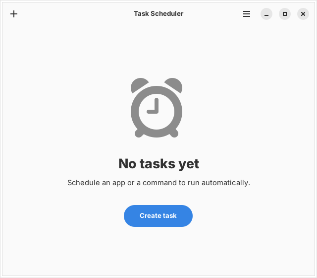

# reveille

GTK4/libadwaita front end for systemd user timers. Create, edit and monitor scheduled tasks without writing unit files.

systemd is the only store. Every task is a plain `.timer` (plus a `.service` for apps and commands) in `~/.config/systemd/user/`, with no database, no JSON file and no special unit prefix. The timers run your command directly and never call reveille, so they keep working if you delete the program. Last-run results come from systemd (`systemctl --user status NAME.service`, `journalctl --user -u NAME.service`).

## Requirements

- Linux with systemd (user session)
- Python 3
- systemd 244+ for retries, 249+ for "Then run", 254+ for "Wake the computer from sleep" (the editor greys these out on older versions)
- PyGObject, GTK 4, libadwaita 1.5+ (the editor uses `Adw.Dialog`)

## Usage

    ./reveille              open the window
    ./reveille install      add to the app menu
    ./reveille uninstall    remove from the app menu
    ./reveille services     list services the picker finds
    ./reveille list         print every task with its schedule, next run and last result
    ./reveille list --json  the same as JSON, for scripts
    ./reveille enable NAME  turn a task's timer on (disable NAME turns it off)
    ./reveille logs NAME    print the last 200 lines of its journal (-n N for another count)
    ./reveille new NAME --command CMD --at 09:00   create a task (or --every 15min, --calendar EXPR, --login; --days, --wake, --disabled, --dry-run to see the unit files first)
    ./reveille run NAME     run a task or service now (task name or unit name)
    ./reveille import-cron  preview turning your crontab into tasks (add --apply to create them)
    ./reveille --version    print the version (--help lists all commands)

## Editing

The window lists every timer in `~/.config/systemd/user/`, whether reveille wrote it or you did. Saving rewrites only the lines the editor manages (name, schedule, command or app, working directory, environment, timeout, retries, low priority, path condition, "Then run", AC power, network wait, wake from sleep). Every other line, comment and section, such as `ExecCondition=` or `SyslogIdentifier=`, stays as it was, and an unchanged command is kept exactly as written.

A task is limited to schedule-only editing, with the reason shown in the editor, when a managed setting can't be represented: several `ExecStart=` lines, an `ExecStart=-…` prefix, a timeout that isn't whole minutes, several `ConditionPathExists=` lines, an `OnSuccess=` or `OnFailure=` with several units, or a `Restart=` other than `on-failure`. The original timer is then backed up once as `NAME.timer.reveille-bak`. Switching a task to an existing service moves its own service file to `NAME.service.reveille-bak`.

Drop-ins (`NAME.service.d/*.conf`, `NAME.timer.d/*.conf`) are noticed so the editor never shows a setting systemd doesn't run. A drop-in that sets a managed setting (for example `ExecStart=`, `Environment=` or `OnFailure=`) limits the task to schedule-only editing and the reason names the file. One that changes the schedule makes the timer open as a read-only file view. Any other drop-in only adds a note. Reveille never changes or deletes drop-ins.

Delete is in the editor of every task (even schedule-only ones), and clicking a service without a timer opens an editor with a Delete service button. A timer whose schedule can't be shown at all (for example `OnActiveSec=`) opens a read-only view of its file with Open file and Delete task buttons. A confirmation lists the exact files first. A timer is deleted with its same-named `.service` unless another timer still triggers it. Symlinks are removed as links (their target is kept), backups and `.d` folders are never touched, and Undo restores everything, including links.

Services without a timer are listed separately; click one to schedule it. With six or more rows a filter box appears; every word you type must appear in a row's name, schedule or status.

`install` only adds the app-menu entry. It copies the script to `~/.local/share/reveille/` so moving the download doesn't break the entry.

## What a row tells you

Each row shows the schedule in plain words ("Weekdays at 09:00", "Every 90 minutes"), when it runs next and when it last ran ("in 12 min", "yesterday 03:00"); hover for exact times. A running task says so. The switch shows whether the timer is active, and the row says when that differs from what a restart will do: "Not enabled: won't start again after a restart" or "Stopped, starts again at next login". Timers without an `[Install]` section can't be enabled, so the switch falls back to plain start and stop, and if systemd refuses, the reason is shown.

## Reliability options

Under Advanced in the editor. They apply to apps and commands, not to a task that triggers an existing service (which keeps its own settings), except wake from sleep, which is a timer setting.

- **Retry on failure**: how many times to retry (up to 10) and how many minutes to wait. Written as `Restart=on-failure`, `RestartSec=` and a matching `StartLimitBurst=`. systemd stops retrying at the limit; the limit window is sized to hold every try (one hour per run unless a timeout is set). A schedule shorter than that window is therefore refused, and a manual run is refused while the limit is in effect. While waiting, the row says "Waiting to retry".
- **Run at low priority**: `Nice=19` and `IOSchedulingClass=idle`. A different `Nice=` or `IOSchedulingClass=` you wrote by hand is left alone while this is off.
- **Only if this path exists**: `ConditionPathExists=`. Start the path with `!` to require that it is missing. A failed condition skips the run without error.
- **Then run**: starts another service after this one succeeds (`OnSuccess=`).
- **If it fails, run**: starts another service when this one fails (`OnFailure=`), after the last retry if there are any. Choose `reveille-notify@%n.service` for a notification (reveille creates that helper; it needs `notify-send`). Both pickers refuse a choice that would make tasks run each other in a loop.
- **Wake the computer from sleep**: `WakeSystem=true`, so a suspended computer resumes when the task is due (nothing suspends it again). Needs hardware support and, in a user session, systemd 254 or newer. On the command line: `new ... --wake`.
- **Wait for the network**: waits up to 60 seconds (`nm-online` if installed, else an IPv4 default route), then runs anyway. A user session has no `network-online.target`, so ordering against it does nothing.

## Importing a crontab

In the window: main menu, **Import from crontab…**. A review dialog lists every entry with its schedule in words, next run and any warnings; tick the ones to import (entries that can't be converted or already exist are shown but can't be ticked). New timers are created switched off unless you turn on "Switch the new timers on". On the command line:

    ./reveille import-cron                 preview what `crontab -l` would become
    ./reveille import-cron --apply         create the tasks
    ./reveille import-cron --apply --disabled   create them with the timers switched off
    ./reveille import-cron --file FILE     read a saved crontab instead (- for standard input)

Nothing is written without `--apply`, and your crontab is never changed: remove the imported lines yourself (`crontab -e`), or those jobs will run twice. Running it again skips entries that are already tasks.

- Schedules follow cron's wall clock, so `*/15 * * * *` becomes a calendar expression (`*:0/15`), not an interval. When both day of month and weekday are set, cron runs on either; that is written as two schedules. `@daily`, `@weekly` (Sunday, as in cron) and the other macros work; `@reboot` becomes "At login".
- Commands that need a shell (pipes, redirects, `cd`, variables) run as `SHELL -c '…'`. `\%` becomes `%`; an unescaped `%` (newline and input in cron) is not imported.
- `VAR=value` lines above an entry become its environment, and `SHELL=` picks the shell. `MAILTO=` is not carried over (output goes to the journal; use "If it fails, run") and `CRON_TZ=` is not applied.
- Imported tasks do not catch up on missed runs, as in cron. The task name is the comment line directly above the entry, else the command's name.
- Entries that can't be converted (out-of-range values, `5/15`-style steps, a command not in `PATH`) are listed with the reason and skipped. Only your own crontab is read, not `/etc/crontab` or `/etc/cron.d`.

## Logs and running while logged out

Every task row has a log button showing the last 200 lines of the service's journal, with Reload, Copy and a Follow toggle. Services without a timer have it too. Run now starts the task and opens the log already following (apps have no output, so they just show "Started").

User timers only run while your user session is running; when logged out, or after a restart until you log in, they wait. If tasks exist and lingering is off, a banner offers to turn it on (`loginctl enable-linger`); "Not now" hides it until the next start. The main menu can turn lingering on or off at any time. With lingering on, "At login" tasks run at boot; apps still need a desktop session, so mostly commands benefit.

## Triggers

- **Daily**, **Weekdays** (Mon to Fri), **Weekly** (pick the days), **Monthly** (day 1 to 28) and **Last day of the month**, each at a time you choose.
- **Several times a day**: clock times such as `08:00, 12:30, 18:00`, one `OnCalendar=` line per time.
- **At an interval**: every N seconds, minutes, hours or days. An optional "First run after login" (for example `OnBootSec=2min` with `OnUnitActiveSec=15min`) defaults to one interval. A hand-written `OnBootSec=` stays `OnBootSec=`, and `1h 30min` reads as 90 minutes. An interval that isn't a whole number of minutes also gets `AccuracySec=1s`, since systemd would otherwise let it fire up to a minute late; changing such a task to another schedule leaves that line in place.
- **At login**: shortly after the session starts. A hand-written delay other than the default 10 seconds is kept on save.
- **Custom**: any systemd calendar expression; separate several with `|`.

Existing timers are recognized in these forms where possible (`Mon..Fri 09:00` shows as Weekdays); anything else stays custom. "Run missed tasks after startup" (`Persistent=true`) is offered for calendar schedules only, since an interval or login has no missed time.

## Files

- Units: `~/.config/systemd/user/NAME.service` and `NAME.timer`, where NAME is derived from the task name

## License

GPL-3.0-or-later. See [LICENSE](LICENSE).
