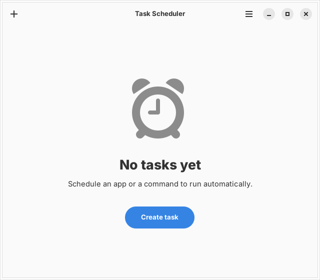

# reveille

GTK4/libadwaita front end for systemd user timers. Create, edit and monitor scheduled tasks without writing unit files.

systemd is the only store. Every task is a plain `.timer` (plus a `.service` for apps and commands) in `~/.config/systemd/user/`, with no database, no JSON file and no special unit prefix. The timers run your command directly and never call reveille, so the units keep working if you delete the program. Last-run results come from systemd itself (`systemctl --user status NAME.service`, `journalctl --user -u NAME.service`).

## Requirements

- Linux with systemd (user session)
- Python 3
- systemd 244 or newer for retries, 249 or newer for "Then run" (the editor greys these out on older versions)
- PyGObject, GTK 4, libadwaita 1.5 or newer (the editor uses `Adw.Dialog`)

## Usage

    ./reveille              open the window
    ./reveille install      add to the app menu
    ./reveille uninstall    remove from the app menu
    ./reveille services     list services the picker finds
    ./reveille list         print every task with its schedule, next run and last result
    ./reveille run NAME     run a task or service now (task name or unit name)
    ./reveille import-cron  preview turning your crontab into tasks (add --apply to create them)
    ./reveille --version    print the version (--help lists all commands)

The window lists every timer in `~/.config/systemd/user/`, whether reveille wrote it or you did. Saving rewrites only the lines the editor manages (name, schedule, command or app, working directory, environment, timeout, retries, low priority, path condition, "Then run", AC power, network wait); every other line, comment and section in the unit files, such as `ExecCondition=` or `SyslogIdentifier=`, stays as it was, and an unchanged command is kept exactly as written. A task is limited to schedule-only editing, with the reason shown in the editor, when a managed setting can't be represented (for example several `ExecStart=` lines, an `ExecStart=-…` prefix or a timeout that isn't whole minutes, several `ConditionPathExists=` lines, an `OnSuccess=` or `OnFailure=` with several units, or a `Restart=` other than `on-failure`). In that case the original timer is backed up once as `NAME.timer.reveille-bak`. Switching a task to an existing service moves its own service file to `NAME.service.reveille-bak`. Delete lives inside the item: the editor of any task has a Delete button (even for timers limited to schedule-only editing), and clicking a service without a timer opens an editor with a Delete service button. A timer whose schedule the editor can't show at all (for example `OnActiveSec=`) opens a read-only view of its file with Open file and Delete task buttons. A confirmation lists the exact files first. A timer is deleted together with its same-named `.service` unless another timer still triggers that service, and a service without a timer is deleted on its own. Symlinks are removed as links (the file they point to is kept), `.reveille-bak` backups and `.d` override folders are never touched, and Undo restores everything, including links. Services without a timer are listed separately; click one to schedule it.

Drop-in overrides (`~/.config/systemd/user/NAME.service.d/*.conf` and `NAME.timer.d/*.conf`) are noticed so the editor never shows a setting systemd doesn't run. If a drop-in sets something the editor manages (for example `ExecStart=`, `Environment=` or `OnFailure=`), the task is limited to schedule-only editing and the reason names the file. If a drop-in changes the schedule itself, the timer opens as a read-only file view instead. Any other drop-in only adds a note listing it. Reveille never reads or changes the contents of these files beyond that, and never deletes them.

`install` only adds the app-menu entry (it copies the script to `~/.local/share/reveille/` so moving the download doesn't break the entry).

## What a row tells you

Each row shows the schedule in plain words ("Weekdays at 09:00", "Every 90 minutes"), when it runs next and when it last ran ("in 12 min", "tomorrow 03:00", "yesterday 03:00"); hover for the exact times. A task that is running right now says so. The switch shows whether the timer is active, and the row says when that differs from what a restart will do: "Not enabled: won't start again after a restart" for a timer that is running but not enabled, "Stopped, starts again at next login" for one that is enabled but stopped. Timers written without an `[Install]` section can't be enabled, so the switch falls back to plain start and stop for them, and if systemd refuses, the reason is shown.

## Reliability options

These live under Advanced in the editor and apply to apps and commands (not to a task that triggers an existing service, which keeps its own settings).

- **Retry on failure**: how many times to try again (up to 10) and how many minutes to wait between tries. Written as `Restart=on-failure`, `RestartSec=` and a matching `StartLimitBurst=`. systemd stops retrying once the limit is reached, and the limit window is sized to hold every try (one hour per run is assumed unless a timeout is set). Two consequences: a schedule shorter than that window is refused, since the next run is the retry there, and a manual run is refused by systemd while the limit is in effect. While a task waits for its next try the row says "Waiting to retry".
- **Run at low priority**: `Nice=19` and `IOSchedulingClass=idle`. A different `Nice=` or `IOSchedulingClass=` you wrote by hand is left alone while this is off.
- **Only if this path exists**: `ConditionPathExists=`. Start the path with `!` to require that it is missing. When the condition fails systemd skips the run without error.
- **Then run**: starts another service after this one succeeds (`OnSuccess=`).
- **If it fails, run**: starts another service when this one fails (`OnFailure=`), for example one that sends you a notification. With retries on, it starts only after the last try has failed, because systemd counts a task as failed only then. Both pickers refuse a choice that would make tasks run each other in a loop, whether the chain goes through success or failure links.

## Importing a crontab

In the window: main menu, **Import from crontab…**. A review dialog lists every entry with its schedule in words, its next run and any warnings; tick the ones to import (entries that can't be converted, or already exist as tasks, are shown but can't be ticked). The timers are created switched off unless you turn on "Switch the new timers on", so nothing runs twice until you decide. On the command line:

    ./reveille import-cron                 preview what `crontab -l` would become
    ./reveille import-cron --apply         create the tasks
    ./reveille import-cron --apply --disabled   create them with the timers switched off
    ./reveille import-cron --file FILE     read a saved crontab instead (- for standard input)

The preview lists every entry with its schedule in words, its next run (checked with `systemd-analyze`) and anything that behaves differently under systemd. Nothing is written unless you add `--apply`, and your crontab is never changed: remove the imported lines yourself (`crontab -e`), or use `--disabled` and switch each task on as you do. Running it again skips entries that are already tasks.

What is carried over, and what is not:

- Schedules follow cron's wall clock, so `*/15 * * * *` becomes a calendar expression (`*:0/15`), not an "At an interval" task. When both day of month and weekday are set, cron runs on either; that is written as two schedules. `@daily`, `@weekly` (Sunday, as in cron) and the other macros work; `@reboot` becomes "At login".
- Commands that need a shell (pipes, redirects, `cd`, variables) run as `SHELL -c '…'`, as cron ran them. `\%` becomes `%`; an unescaped `%` (newline and input in cron) is not imported.
- `VAR=value` lines above an entry become its environment; `SHELL=` picks the shell. `MAILTO=` is not carried over (output goes to the journal; use "If it fails, run" for a notification) and `CRON_TZ=` is not applied.
- Imported tasks do not catch up on missed runs, as in cron. The task name is the comment line directly above the entry, else the command's name.
- Entries that can't be converted (out-of-range values, `5/15`-style steps, a command that isn't in `PATH`) are listed with the reason and skipped. Only your own crontab is read, not `/etc/crontab` or `/etc/cron.d`.

## Logs and running while logged out

Every task row has a log button that shows the last 200 lines of the service's journal (the same as `journalctl --user -u NAME.service`), with Reload and Copy. Services without a timer have it too. The Follow toggle shows new lines as they arrive. Run now starts the task and opens the log already following, so you can watch it work (apps have no output to follow, so they just show "Started").

User timers only run while your user session is running. When you are logged out, or after a restart until you log in, they wait. If tasks exist and lingering is off, reveille shows a banner explaining this and offers to turn it on (`loginctl enable-linger`); "Not now" hides it until the next start. The main menu can turn lingering on or off at any time. With lingering on, "At login" tasks run at boot, and apps still need a desktop session, so mostly commands benefit.

## Triggers

- **Daily**, **Weekdays** (Mon to Fri), **Weekly** (pick the days), **Monthly** (day 1 to 28) and **Last day of the month**, each at a time you choose.
- **Several times a day**: a list of clock times such as `08:00, 12:30, 18:00`, written as one `OnCalendar=` line per time.
- **At an interval**: every N seconds, minutes, hours or days. Optionally set a different "First run after login" (for example `OnBootSec=2min` with `OnUnitActiveSec=15min`); leave it empty to start after one interval. A hand-written `OnBootSec=` is kept as `OnBootSec=` when you save. A hand-written `1h 30min` is read as 90 minutes. An interval that isn't a whole number of minutes also gets `AccuracySec=1s`, because systemd would otherwise let it fire up to a minute late. Changing such a task to another schedule leaves that line in place.
- **At login**: shortly after the session starts. A delay other than the default 10 seconds that you wrote by hand is kept when you save.
- **Custom**: any systemd calendar expression; separate several with `|`.

Existing timers are recognized in these forms where possible (for example `Mon..Fri 09:00` shows as Weekdays), and anything else stays a custom expression. "Run missed tasks after startup" (`Persistent=true`) is offered for the calendar schedules only, since an interval or login has no missed time.

## Files

- Units: `~/.config/systemd/user/NAME.service` and `NAME.timer`, where NAME is derived from the task name

## License

GPL-3.0-or-later. See [LICENSE](LICENSE).
